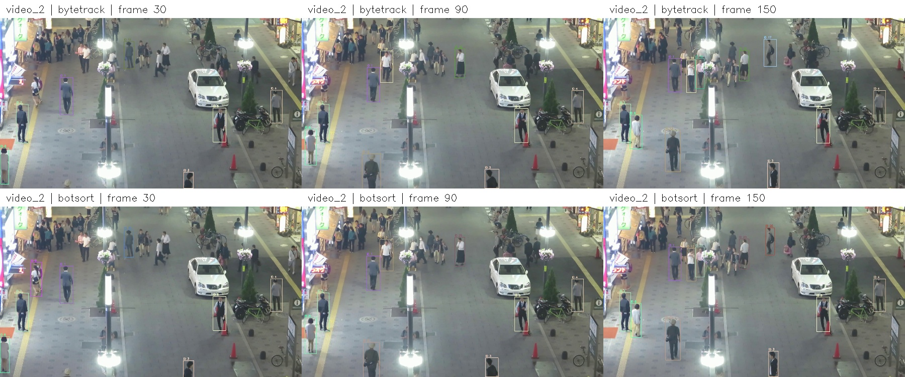
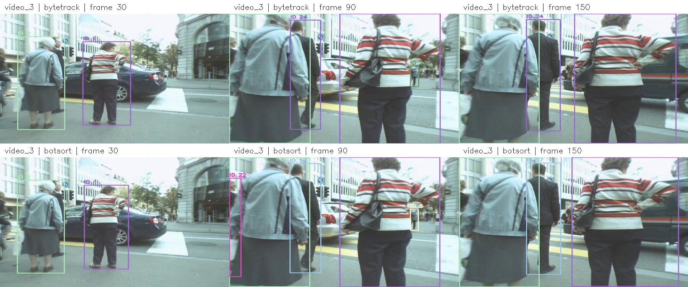
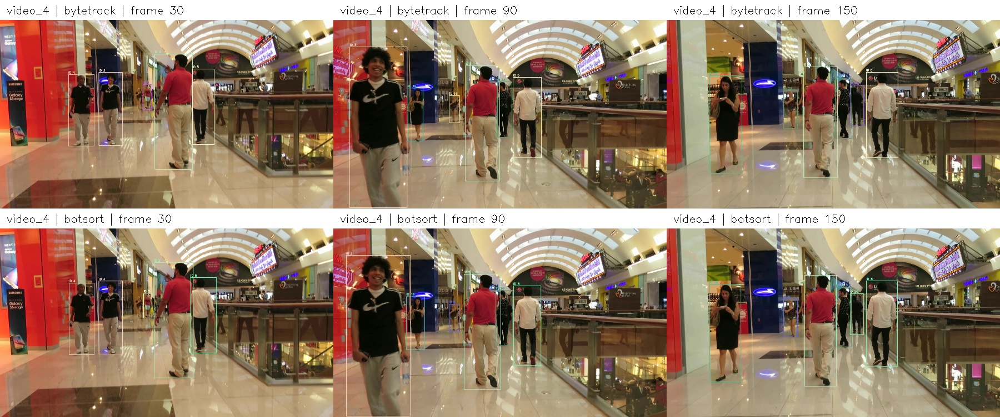
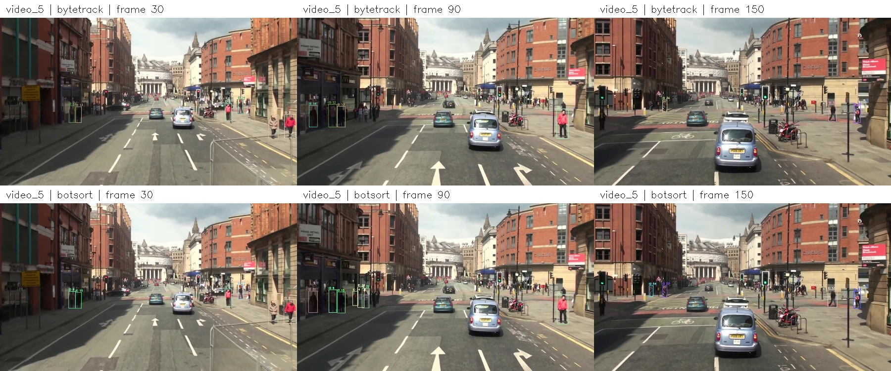

# Báo cáo lab: chọn tracker cho 5 video

**Nhóm:** MotMinhTui  
**Thành viên:** Nguyễn Thị Thùy Dương  
**MSSV:** 2A202602905

Detector cố định: `yolo26n.pt`, ảnh đầu vào 640 px, chỉ lớp người. Re-ID cố định: `osnet_x0_25_msmt17.pt`. Các lượt đầu chạy GPU T4 trên Colab; lượt bổ sung chạy CPU Windows trên máy do hết hạn mức GPU và không nạp được dữ liệu vào Colab; không sửa tham số bên trong tracker.

## 1. Cấu hình đã chọn

| Video | Tracker | conf | iou | Quan sát khi xem video | Đã thử nhưng loại |
|---|---|---:|---:|---|---|
| video_1 | BoT-SORT | 0.3 | 0.7 | HOTA cao nhất trong bảy cấu hình khác nhau, tám lượt chạy đủ 600 frame. MOTA/IDF1 vẫn cho thấy còn lỗi và bỏ sót. | Hai cấu hình ByteTrack và các cấu hình BoT-SORT còn lại trong bảng so sánh. |
| video_2 | BoT-SORT | 0.3 | 0.5 | Frame 30 có hộp cho người áo sáng gần mép trái mà ByteTrack chưa gán hộp; người áo xám đi lên giữ ID 1 ở frame 30/90/150. Nhiều người nhỏ ở vùng xa chưa có hộp ở cả hai tracker. | ByteTrack 0.3/0.5; BoT-SORT conf=0.15/0.5 và iou=0.4/0.7 trong lượt thử ngắn. |
| video_3 | BoT-SORT | 0.3 | 0.5 | Người áo kẻ ngang ở gần camera giữ ID 1 trong ba ảnh mẫu; hai tracker đều bám được người lớn ở tiền cảnh. BoT-SORT có thêm hộp ở rìa ảnh, cần kiểm tra khi người chỉ lộ một phần. | ByteTrack 0.3/0.5 và các biến thể ngưỡng của BoT-SORT. |
| video_4 | BoT-SORT | 0.3 | 0.5 | BoT-SORT giữ ID 2 của người áo đỏ và ID 5 của người áo trắng ở frame 30/90/150. Người áo đen đi ngược hướng camera tăng kích thước rất nhanh giữa frame 30 và 90. | ByteTrack 0.3/0.5 và các biến thể ngưỡng của BoT-SORT. |
| video_5 | BoT-SORT | 0.3 | 0.5 | Ở frame 90, BoT-SORT có thêm hộp trên vỉa hè trái so với ByteTrack. Còn người nhỏ gần giao lộ chưa có hộp; thay đổi góc nhìn làm người ở hai mép ảnh ra/vào nhanh. | ByteTrack 0.3/0.5 và các biến thể ngưỡng của BoT-SORT. |

Các lượt so sánh của video_2–video_5 dùng cùng 150 frame đầu. Bản nộp bên dưới được chạy lại toàn bộ ảnh nguồn. Cả năm video chọn BoT-SORT sau thử nghiệm, ngưỡng video_1 lấy theo bảng chấm; không suy ra BoT-SORT tốt nhất với mọi cảnh.

## 2. Số liệu video_1

Giá trị do TrackEval in ra cho file `video_1.txt` được nộp:

| HOTA | MOTA | IDF1 |
|---:|---:|---:|
| 29.969 | 19.025 | 29.703 |

Bảng so sánh bảy cấu hình khác nhau, tám lượt chạy đủ 600 frame (baseline được chạy lại trên CPU):

| Tracker | conf | iou | Thiết bị | HOTA | MOTA | IDF1 |
|---|---:|---:|---|---:|---:|---:|
| bytetrack | 0.3 | 0.5 | cuda:0 | 26.912 | 17.292 | 25.713 |
| botsort | 0.3 | 0.5 | cuda:0 | 29.460 | 19.811 | 29.354 |
| bytetrack | 0.15 | 0.5 | cuda:0 | 27.314 | 18.314 | 26.987 |
| botsort | 0.15 | 0.5 | cuda:0 | 29.343 | 20.731 | 29.561 |
| botsort | 0.3 | 0.5 | cpu | 29.460 | 19.811 | 29.354 |
| botsort | 0.5 | 0.5 | cpu | 27.167 | 15.252 | 24.558 |
| botsort | 0.3 | 0.4 | cpu | 29.316 | 19.466 | 29.823 |
| botsort | 0.3 | 0.7 | cpu | 29.969 | 19.025 | 29.703 |

Ưu tiên HOTA vì đây là thước đo cân bằng phát hiện và liên kết danh tính. Cấu hình được chọn là BoT-SORT conf=0.3, iou=0.7, thiết bị cpu, HOTA=29.969. So với baseline conf=0.3/iou=0.5, HOTA của cấu hình chọn thay đổi +0.509 điểm, MOTA -0.786 điểm và IDF1 +0.349 điểm. Đây là đánh đổi giữa các metric; lựa chọn ưu tiên HOTA, không coi cả ba metric đều được cải thiện. Các số tuyệt đối vẫn thấp; chất lượng phát hiện và bỏ sót người còn là hạn chế đáng kể.

Đã bổ sung conf=0.5 (giữ iou=0.5), iou=0.4 và 0.7 (giữ conf=0.3); mỗi lần chỉ đổi một ngưỡng. Do Colab hết hạn mức GPU, ba lượt này chạy CPU Windows trên máy và thêm baseline CPU conf=0.3/iou=0.5 để kiểm tra ảnh hưởng của thiết bị và môi trường. HOTA baseline CPU là 29.460, baseline GPU là 29.460, chênh lệch +0.000 điểm; MOTA/IDF1 CPU lần lượt 19.811/29.354. So sánh ba ngưỡng bổ sung với baseline CPU để tránh quy mọi thay đổi cho ngưỡng khi thiết bị và môi trường cũng thay đổi.

Khi giữ iou=0.5, tăng conf từ 0.3 lên 0.5 làm HOTA đổi từ 29.460 xuống 27.167; MOTA/IDF1 ở conf=0.5 là 15.252/24.558. Vì vậy loại conf=0.5 trong video_1. Khi giữ conf=0.3, iou=0.4 và 0.7 có HOTA lần lượt 29.316 và 29.969; bảng trên ghi đầy đủ hai metric còn lại. Quyết định cuối dùng HOTA cao nhất trong các lượt đã kiểm chứng, không suy đoán từ số hộp xuất ra.

TrackEval ghi 14402 lượt bỏ sót, 611 lượt phát hiện sai và 33 lần đổi ID ở cấu hình được nộp. Đây là số đếm qua các frame theo quy tắc chấm, không phải số người riêng biệt. Báo cáo giữ rõ hạn chế này thay vì kết luận hệ thống đã bám tốt mọi người.

`video_2`–`video_5` không có nhãn: không tính HOTA, MOTA hay IDF1 cho các video này. Gói dữ liệu thiếu `eval_config.json`, nên dùng cấu hình MOT mặc định trong `LAB-train`, giữ nguyên nhãn video_1. Bảng tổng hợp của cấu hình được nộp nằm trong video_1_summary.txt.

## 3. Phân tích theo cảnh

### Video_2 — camera tĩnh, ban đêm, đông người

Ở frame 30, người áo sáng gần mép trái được BoT-SORT gán hộp trong khi ảnh ByteTrack tương ứng chưa có hộp. Trong ba ảnh mẫu, cả hai tracker vẫn giữ ID 1 của người áo xám đi lên, nên không thể coi mọi phần giữ ID của ByteTrack đều kém hơn. Cụm người nhỏ ở xa và vùng tối vẫn bị bỏ sót ở cả hai cấu hình. Chọn BoT-SORT để có thêm thông tin ngoại hình khi người đứng gần hoặc che khuất nhau; giữ conf=0.3 làm mức trung gian giữa hai ngưỡng đã thử.

### Video_3 — camera di chuyển, ảnh nhỏ

Người mặc áo kẻ ngang vẫn mang ID 1 ở frame 30, 90 và 150 trong cả hai lượt. Khi camera tiến gần, người áo xám chiếm phần lớn mép trái, còn người áo kẻ tăng kích thước rõ rệt; việc ghép chỉ bằng vị trí/IoU vì vậy khó hơn khi bị che khuất. Chọn BoT-SORT vì có Re-ID hỗ trợ danh tính trong tình huống camera chuyển động. Tuy nhiên, ảnh mẫu chưa chứng minh BoT-SORT giữ ID tốt hơn trong mọi đoạn; hộp bổ sung ở rìa ảnh cần được xem thận trọng khi chỉ thấy một phần người.

### Video_4 — trong nhà, camera tiến tới, nền phản chiếu

Ở BoT-SORT, người áo đỏ và người áo trắng giữ lần lượt ID 2 và ID 5 qua ba ảnh mẫu. Người áo đen đi ngược chiều camera chuyển từ hộp nhỏ ở frame 30 thành hộp lớn ở frame 90, cho thấy thay đổi tỷ lệ nhanh. Re-ID là lý do chọn BoT-SORT để hỗ trợ ghép danh tính khi vị trí và kích thước hộp đổi mạnh. Nền bóng và kính khiến cần xem kỹ hộp trên vùng phản chiếu; không đánh đồng một hộp xuất hiện thêm với một người thật được phát hiện đúng.

### Video_5 — camera trên xe, chuyển động nền mạnh

Frame 90 cho thấy BoT-SORT xuất thêm hộp ở vỉa hè bên trái so với ByteTrack; nhiều người nhỏ gần giao lộ vẫn chưa được gán hộp. Người ở rìa ảnh thay đổi vị trí và kích thước nhanh khi xe tiến tới. Chọn tracker có thông tin ngoại hình để hỗ trợ liên kết khi nền và camera cùng chuyển động. Quan sát này chỉ nói về ảnh mẫu, không đủ để kết luận mọi hộp bổ sung đều đúng hoặc không có đổi ID trong toàn bộ video.

### Thử ngưỡng có hệ thống

Với bốn video chưa có nhãn và BoT-SORT, đã thử conf=0.15/0.3/0.5 và iou=0.4/0.5/0.7; mỗi lần chỉ đổi một giá trị so với baseline 0.3/0.5. Mỗi biến thể dùng 150 frame đầu, cùng trọng số, kích thước ảnh và thiết bị. Bảng dưới ghi số hàng tracking xuất ra để đối chiếu lượt chạy; đây không phải số người đúng hay thước đo độ chính xác. Giữ cấu hình trung gian 0.3/0.5 cho bản nộp bốn video chưa có nhãn, dựa trên ảnh so sánh và tính thận trọng khi không có nhãn kiểm chứng.

Tại frame 90 của video_3, conf=0.5 không giữ hộp của người nhỏ ở hậu cảnh phía phải người áo kẻ, trong khi conf=0.3 vẫn có hộp. Trong video_5, conf=0.5 cũng giữ ít hộp hơn trên vỉa hè trái ở frame 90, dù nhiều người vẫn nhìn thấy được. Trong video_2, conf=0.15 thêm hộp ở cụm người trung tâm, còn conf=0.5 mất hộp của người áo sáng đứng gần giữa ảnh. Vì vậy không chọn ngưỡng cao 0.5; giữ 0.3 để hạn chế bỏ sót mà không mặc định coi mọi hộp bổ sung ở ngưỡng 0.15 đều đúng. Video_4 cho thấy các hộp tiền cảnh chính còn ở cả ba mức, nhưng người nhỏ ở xa ít được giữ hơn ở 0.5.

| Video | conf | iou | Số hàng tracking trong 150 frame |
|---|---:|---:|---:|
| video_2 | 0.15 | 0.5 | 1720 |
| video_2 | 0.5 | 0.5 | 1125 |
| video_2 | 0.3 | 0.4 | 1543 |
| video_2 | 0.3 | 0.7 | 1564 |
| video_3 | 0.15 | 0.5 | 848 |
| video_3 | 0.5 | 0.5 | 569 |
| video_3 | 0.3 | 0.4 | 764 |
| video_3 | 0.3 | 0.7 | 881 |
| video_4 | 0.15 | 0.5 | 1037 |
| video_4 | 0.5 | 0.5 | 782 |
| video_4 | 0.3 | 0.4 | 958 |
| video_4 | 0.3 | 0.7 | 958 |
| video_5 | 0.15 | 0.5 | 994 |
| video_5 | 0.5 | 0.5 | 527 |
| video_5 | 0.3 | 0.4 | 907 |
| video_5 | 0.3 | 0.7 | 916 |

Ảnh `quan_sat/video_N_nguong.jpg` đối chiếu ba mức conf tại frame 90. Ảnh `quan_sat/video_N_daydu.jpg` kiểm tra frame 150, khoảng giữa và frame cuối của bản nộp đầy đủ. Những ảnh mẫu này giúp kiểm tra kết quả, không thay thế việc xem liên tục video khi đánh giá đổi ID.

Ở bản đầy đủ, video_2 tại frame 526 và 1050 vẫn có nhiều người nhỏ chưa được gán hộp ở vùng xa. Video_3 tại frame 419/837 có nhiều người mới đi vào sát camera; video_4 tại frame 451/900 thay đổi khoảng cách giữa camera và người đi phía trước; video_5 tại frame 376/750 chuyển từ giao lộ sang đoạn phố mới. Các ảnh cuối có nội dung khác ảnh đầu, giúp kiểm tra bản xuất không bị lặp một frame hoặc dừng ở mốc 150.

## 4. Kiểm tra bài nộp

| Video | Ảnh nguồn | Frame trong preview | Số hàng MOT | Kiểm tra |
|---|---:|---:|---:|---|
| video_1 | 600 | 600 | 4991 | OK |
| video_2 | 1050 | 1050 | 12310 | OK |
| video_3 | 837 | 837 | 4760 | OK |
| video_4 | 900 | 900 | 6220 | OK |
| video_5 | 750 | 750 | 3047 | OK |

Năm file có đúng tên, 10 cột MOT, không trùng ID trong cùng frame, không có NaN/vô cực; hộp có chiều rộng và chiều cao dương. Preview các bản cũ đã kiểm tra trên Colab; nếu video_1 được thay bằng lượt CPU thì preview mới được kiểm tra lại trên máy; file `.txt` không bắt buộc có dòng ở frame không có track. Tất cả cấu hình nộp có max_frames=0.

## 5. Nếu có thêm thời gian

Quét conf mịn hơn quanh 0.15–0.3 và xem liên tục các đoạn che khuất hoặc người cắt nhau để phân biệt bỏ sót phát hiện với đổi ID. Giữ detector và Re-ID cố định trong bài chính, chỉ thử mô hình khác ở phần mở rộng sau khi nộp.
